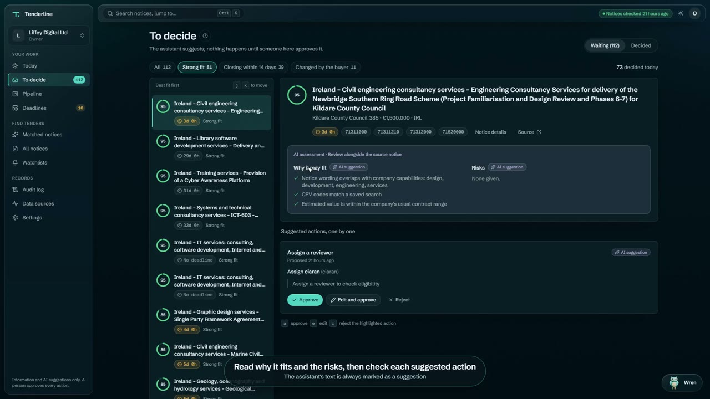
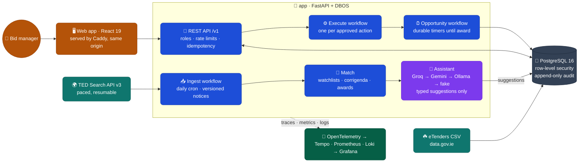

<div align="center">

# 📜 Tenderline — Public Tenders, Found, Judged and Tracked

**A multi-tenant app for small Irish companies bidding on public contracts. It finds the tenders that fit, has an AI assistant suggest what to do, and does nothing until a person says yes.**

[](https://github.com/abinashprasana/tenderline/actions/workflows/ci.yml)
[](https://python.org)
[](https://fastapi.tiangolo.com)
[](https://www.postgresql.org)
[](https://www.dbos.dev)
<br/>
[](https://react.dev)
[](https://www.typescriptlang.org)
[](https://tailwindcss.com)
[](https://opentelemetry.io)
[](docker-compose.yml)
<br/>
[](tests/)
[](frontend/e2e/app.spec.ts)

<br/>

*TED (Tenders Electronic Daily) · eTenders open data · human-in-the-loop AI · Oracle Cloud Always Free*

</div>

---

## 📖 What this is

An Irish SME that sells to the public sector has the same problem every week: hundreds of new notices on TED and eTenders, a handful worth bidding on, and deadlines that do not move. Reading them all is a part-time job. Missing one is worse.

Tenderline does the reading. Every day it collects new notices, checks each one against the company's **watchlists**, and passes the matches to an **AI assistant** that scores the fit from 0 to 100, lists its reasons and risks, and suggests up to five concrete actions: track it, set reminders, assign a reviewer, draft a clarification question, or pass on it.

Then it stops. **Nothing the assistant suggests runs until a person approves it.** Approved actions run as durable workflows that survive crashes and restarts, every deadline is watched until the award is published, and every suggestion and decision is written to an append-only audit log.

> ⚖️ Tenderline gives information and AI suggestions only. It is not legal or procurement advice.

---

## 🎬 See it in action

<div align="center">

<a href="demo/tenderline-walkthrough.mp4"></a>

**[▶ Watch the 4-minute walkthrough](demo/tenderline-walkthrough.mp4)** (1080p, no sound needed)

</div>

A new company sets itself up and gets its first assessed tenders in about a minute. Then a company that has used Tenderline for a while goes through a normal week: Today, deciding suggestions, the pipeline, deadlines, searching notices, Wren the guide, the audit log and settings.

---

## ⚡ Quick stats

<div align="center">

| 🔌 API operations | 🧪 Backend tests | 🧩 Frontend unit tests | 🎭 End-to-end tests | 🏷️ CPV labels | 📐 ADRs |
|:---:|:---:|:---:|:---:|:---:|:---:|
| **46** | **191** | **47** | **13** | **9,454** | **6** |

| 🚀 Landing page LCP | 📦 Initial JavaScript | 📏 Layout shift | ♿ Accessibility | 📈 k6 p95 read / write |
|:---:|:---:|:---:|:---:|:---:|
| **~1.1 s** (budget 2.5 s) | **246 KB** (budget 250 KB) | **0.00** | **0 serious axe findings, both themes** | **208 ms / 489 ms** |

</div>

<sub>Performance measured on the production build in Chrome; k6 figures from the committed run in <code>k6/results-*.json</code>.</sub>

---

## 🧠 How it works



DBOS keeps workflow state in a second database on the same Postgres instance (`tenderline_dbos`), so an approved action or a deadline timer resumes exactly where it stopped after a crash or a deploy. Three small schedules keep things honest: one restarts approved actions whose start was lost to a crash, one gives every open opportunity a live workflow after a deploy, and one deletes old workflow records.

### 📈 A tender's life in the pipeline

**New → Bidding → Submitted → Won or Lost**, with **No bid** reachable from New or Bidding (and back to Bidding on a change of mind). Won and Lost are read from the published award notice and recorded automatically.

The API refuses any other move (`409 invalid_transition`), and the web app only lets you drop a card on a column it can actually move to.

---

## 🖥️ The web app

A Vite + React 19 single-page app in `frontend/`, served by Caddy on the same origin as the API. Dark first, with a separately tuned light theme. Glass effects only on the frame around content, so data always sits on solid, readable panels.

| Screen | What it is for |
|:--|:--|
| 🌅 **Today** | One "do this next" card chosen by fixed rules, what changed since your last visit, the next 30 days with the nearest deadlines named, the pipeline at a glance and how well waiting notices fit. |
| 📥 **To decide** | The assistant's suggestions, best fit first, with its reasons and risks. Approve, edit then approve, reject, or **approve all** for a notice in one step. Keyboard: `j` `k` `a` `e` `r`. |
| 📋 **Pipeline** | A kanban board. Cards only drop where the status machine allows; a refused move slides back. |
| ⏰ **Deadlines** | This week / next week / later, a month heatmap, and an iCalendar export for Outlook or Google Calendar. |
| 🎯 **Matched notices** | Everything each watchlist caught, and why. |
| 🔎 **All notices** | Filters that live in the URL, a virtualised list, hover previews, version history with diffs, and "watch for notices like these". |
| 🔔 **Watchlists** | Categories (CPV), keywords, buyers, countries and value range, with a live "about N open notices match" estimate. |
| 📜 **Audit log** | Every suggestion and decision, searchable, with before-and-after diffs and trace ids. |
| 📡 **Data sources** | When TED and eTenders were last collected, and when the next run is due. |
| ⚙️ **Settings** | Company profile with a completeness meter, members and roles, theme, transparency and guide preferences. |
| 🦉 **Wren, the guide** | An owl in the corner (press `w`) that explains the screen you are on and, when you type what you want to do, flies to the right control. It stays still unless you ask for help. 3D on desktop, a flat version on phones and under reduced motion. |

New users get a three-step setup (company → what to watch for → a live view of the first tenders arriving) that ends on their first real decision. Help appears in place: each screen introduces itself once, the `?` button brings it back, and terms like *fit* and *CPV* explain themselves on hover. There is no pop-up tour.

---

## 🛡️ Guardrails

<details>
<summary><b>🙋 The assistant cannot act on its own</b></summary>

<br/>

The model can only return one of five typed actions, each validated against a strict Pydantic schema with `extra="forbid"`. Output that adds fields, invents an action or breaks a limit is dropped. Valid suggestions are stored as *proposals*; only the approve endpoint, called by a person with the right role, starts the workflow that runs them. Reviewer suggestions use opaque labels, never user ids, so a planted name in a notice cannot assign anyone. See [ADR 0003](docs/adr/0003-agent-cannot-act-without-approval.md).

</details>

<details>
<summary><b>🏢 One organisation can never see another's data</b></summary>

<br/>

Tenant isolation is enforced by **Postgres row-level security**, not by remembering to add a filter. The app connects as a role that is not the table owner and cannot bypass RLS, and every request runs in a transaction scoped with `set_config('app.org_id', …, true)`. Addressing another tenant's organisation returns `404`, so ids cannot be probed. See [ADR 0004](docs/adr/0004-tenant-isolation.md).

Tenant-owned tables (`memberships`, `saved_searches`, `matches`, `opportunities`, `deadlines`, `agent_proposals`, `approvals`, `audit_log`, `llm_calls`, `idempotency_keys`, plus `organisations`) have row-level security. Notices, buyers, CPV codes and ingestion runs are shared public data.

</details>

<details>
<summary><b>🔁 Retries never run an action twice</b></summary>

<br/>

Every create or execute request carries an `Idempotency-Key`. The server stores the first response and replays it for a retry with the same body, and refuses a reused key with a different body (`422`). Execute workflows take the proposal id as their workflow id, so DBOS runs each approved action exactly once. Crash tests kill real worker processes mid-workflow and assert there is no duplicate.

</details>

<details>
<summary><b>📝 Notice text is treated as untrusted</b></summary>

<br/>

Buyer text reaches the model as quoted data, never as instructions, and anything the model writes is shown in the UI labelled **AI suggestion**. Buyer free text is not republished: only a short summary (at most 280 characters) and a link to the source notice are exposed.

</details>

<details>
<summary><b>🔍 Everything leaves a trail</b></summary>

<br/>

`audit_log` and `notice_versions` are append-only: database triggers reject `UPDATE`, `DELETE` and `TRUNCATE`, even for the table owner. Each audit entry carries the OpenTelemetry trace id, so a decision in the UI can be followed into Tempo.

</details>

---

## 🧪 Testing and verification

| Layer | What it proves | Count |
|:--|:--|--:|
| 🐍 **Backend** (pytest, real Postgres) | Tenant isolation at SQL and API level, approvals, idempotency, notice versions and corrigenda, OAuth, rate limits, tracing, and crash recovery with real killed workers | **191** |
| 🧩 **Frontend unit** (Vitest) | The fetch wrapper (429 retry with the same key, 401, 204), error text, money formatting, payload validation, roles, next-best-action rules, the calendar file, suggestion paging, guide tasks and Wren's flight paths | **47** |
| 🎭 **End to end** (Playwright) | Guided setup to first decision, approve all, edit then approve, reject, a decision made elsewhere (409), pipeline moves, calendar download, watchlist from filters, the guide and Wren, phone width, reduced motion and transparency, the landing page budget | **13** |
| ♿ **Accessibility** (axe-core) | WCAG 2.1 AA on every screen, dark and light, with zero serious or critical findings | all screens |
| 📊 **Load** (k6) | Read and write scenarios against seeded data, with p95 and error-rate thresholds | 2 scenarios |
| 🔁 **Drift checks** (CI) | Migrations match the models, the OpenAPI spec matches the code, the TypeScript client matches the spec, the payload schemas match the backend | 4 |

**No test calls the live TED API or a real LLM**: a socket guard fails any test that tries to leave the machine.

---

## 📁 Project structure

```
tenderline/
├── 🐍 src/tenderline/
│   ├── 🔌 api/                 FastAPI app, dependencies, 9 routers
│   ├── 🤖 agent/               qualification prompt, provider chain, typed schemas, tools, evaluation
│   ├── ⚙️ workflows/           ingest, match, qualify, execute, opportunity timers, maintenance
│   ├── 🌍 ted/                TED Search API v3 client and parser
│   ├── 🗄️ migrations/          Alembic: schema, RLS, roles, append-only triggers
│   ├── 🎯 matching.py          watchlist rules, SQL-prefiltered backfill
│   ├── 📋 opportunities.py     status machine and transitions
│   ├── 🏷️ cpv.py               official CPV 2008 label loader
│   ├── 📡 observability.py     OpenTelemetry traces, metrics, logs
│   └── 🧰 cli.py               migrate · serve · ingest · etenders-load · cpv-load · demo · seed · eval-agent
├── 🖥️ frontend/
│   ├── src/screens/            Today, To decide, Pipeline, Notices, Deadlines, Watchlists, Audit, …
│   ├── src/api/                generated types, client, query hooks
│   ├── e2e/                    Playwright flows, axe scans, performance budget
│   ├── caddy/                  shared site snippet: SPA + same-origin API proxy + CSP
│   └── Dockerfile              Node build → Caddy image
├── 🧪 tests/                   unit · contract · integration · workflows (crash recovery)
├── ☁️ terraform/               Oracle Cloud Always Free: network, firewall, Ampere VM, backup bucket
├── 📡 observability/           OTel Collector, Tempo, Loki, Prometheus rules, Grafana dashboard
├── 📊 k6/                      load-test scenarios and committed results
├── 🏷️ data/                    CPV 2008 English labels, synthetic evaluation set
├── 📚 docs/                    ADRs, OpenAPI spec, migration example
├── 🐳 docker-compose.yml       the whole stack, one command
└── 🚀 docker-compose.prod.yml  production: Caddy with TLS, nightly backups
```

---

## ⚙️ How to run

**1. Start everything** (no accounts, no API keys)

```bash
docker compose up --build
```

This starts Postgres, the API (migrations run on boot), the web app and the observability stack. The assistant defaults to a deterministic fake provider, so it works offline.

| What | Where |
|:--|:--|
| 🖥️ Web app (sign in with any local account name on a dev server) | http://localhost:8080 |
| 🔌 API + Swagger UI | http://localhost:8000/docs |
| 📊 Grafana ("Tenderline overview" dashboard) | http://localhost:3000 |
| 🔥 Prometheus (alert rules) | http://localhost:9090 |

**2. Fill it with real notices**

```bash
docker compose exec app tenderline demo
```

The demo ingests **real** TED notices, matches them, shows the assistant's suggestions, approves through the API, then prints the resulting opportunity, reminders and audit entries.

**3. Run the tests**

```bash
docker compose up -d db                 # real Postgres on localhost:5433
uv sync && uv run pytest                # backend: unit, contract, integration, workflows
uv run ruff check src tests scripts && uv run mypy
cd frontend && npm ci && npm test       # frontend unit tests
E2E_BASE_URL=http://localhost:8080 npx playwright test   # end to end, needs notices in the database
```

<details>
<summary>🛠️ More commands</summary>

```bash
# Work on the web app with hot reload (API from compose on :8000)
cd frontend && npm run dev              # http://localhost:5173

# Use a local model instead of the fake one
LLM_PROVIDER_CHAIN=ollama docker compose --profile ollama up

# Data and maintenance
tenderline ingest --since 2026-11-01    # start a TED ingestion now
tenderline etenders-load FILE.csv       # load the eTenders open-data file
tenderline cpv-load cpv_2008.xml        # reload CPV labels from the official XML
tenderline eval-agent data/eval/sample_labelled.jsonl
tenderline openapi && tenderline action-schemas

# Load test (dockerised k6; prints p95 and error rate)
scripts/loadtest.sh
```
</details>

---

## ☁️ Deploy

| Piece | What it does |
|:--|:--|
| ☁️ `terraform/` | Oracle Cloud Always Free: VCN, firewall, one Ampere A1 VM (2 OCPU / 12 GB), backup bucket. Validated in CI, never applied for you. |
| 🚀 `docker-compose.prod.yml` | Caddy with automatic TLS serving the web app and proxying the API, Postgres, nightly backups. |
| 🔄 `.github/workflows/ci.yml` | Lint, types, tests, drift checks, Playwright, multi-arch API and web images to GHCR, and an SSH deploy that only runs when its secrets exist. |

The accounts, keys and exact variable names are in **[SETUP.md](SETUP.md)**. Backup and restore: `scripts/backup.sh`, `scripts/restore.sh`.

---

## ⚠️ Limitations

**🔔 Reminders stay inside the app.** A reminder is recorded and shown, but no email or message is sent. Until a mail provider is added, the iCalendar export is how reminders reach someone who is not logged in.

**🤖 The assistant's quality is not yet measured.** `data/eval/sample_labelled.jsonl` is a synthetic set with hand-written labels, there to exercise the evaluation command. Judging a real model needs notices labelled by real bid managers.

**📄 Lists are capped.** To decide loads up to 2,000 suggestions; Matched notices and Pipeline load the 200 most recent. That suits a small company, but a very broad watchlist would be cut off.

**🔑 The session token lives in session storage.** A strict Content-Security-Policy is what protects it. Cookie sessions with CSRF protection would be the upgrade for a large public deployment ([ADR 0006](docs/adr/0006-web-app.md)).

**🔍 Not verified without real credentials:** the Groq, Gemini, Ollama and Langfuse paths, Grafana Cloud export, the OCI apply, the SSH deploy, TLS issuance and a real GitHub OAuth round trip. Their request formats follow each provider's public API and are tested only against mocked HTTP.

---

## 📐 Architecture decisions

| ADR | Decision |
|:--|:--|
| [0001](docs/adr/0001-dbos-vs-temporal-vs-postgres-queue.md) | 🔁 DBOS Transact over Temporal or a plain Postgres queue |
| [0002](docs/adr/0002-postgres-on-vm-vs-managed.md) | 🐘 Postgres on the VM rather than a managed free tier |
| [0003](docs/adr/0003-agent-cannot-act-without-approval.md) | 🙋 Why the assistant cannot act without human approval |
| [0004](docs/adr/0004-tenant-isolation.md) | 🏢 Tenant isolation with row-level security |
| [0005](docs/adr/0005-deviations-from-the-brief-and-docs.md) | 🧭 Where reality differed from the brief or the docs |
| [0006](docs/adr/0006-web-app.md) | 🖥️ The web app: same origin, design system, guidance and wording |

Also: [backwards-compatible migration example](docs/migrations.md) · [SETUP](SETUP.md) · [OpenAPI spec](docs/openapi.json)

---

## 📚 Data licence and attribution

- 🌍 **TED (Tenders Electronic Daily):** notice data © European Union, https://ted.europa.eu. Reuse is subject to the [TED legal notice](https://ted.europa.eu/en/legal-notice).
- ☘️ **eTenders:** "Contract Notices Published on eTenders", Office of Government Procurement, via data.gov.ie, licensed [CC BY 4.0](https://creativecommons.org/licenses/by/4.0/).
- 🏷️ **CPV 2008 labels** (`data/cpv/cpv_2008_en.csv`): the Common Procurement Vocabulary, Regulation (EC) No 213/2008, as published by the Publications Office of the EU on TED (https://ted.europa.eu/en/simap/cpv). © European Union.
- ✂️ Buyer free text is not republished: only a short summary (at most 280 characters) and a link to the source notice are exposed; raw payloads are kept internally for replay. The same text is served by `GET /v1/metadata`.

---

## 👤 Author

**Abinash Prasana Selvanathan**

*If this was useful, a ⭐ on the repo is welcome.*
