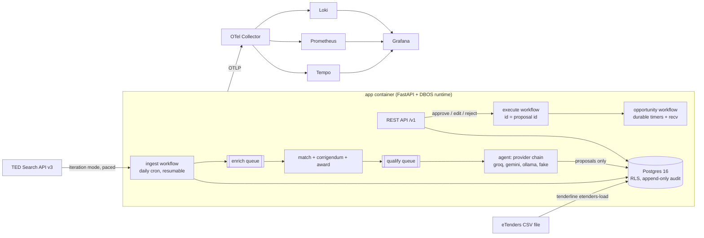
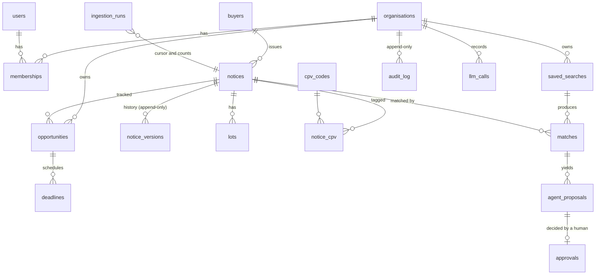

# Tenderline

A multi-tenant backend for small Irish companies that bid for public contracts. It ingests public procurement notices daily, matches them to each company's saved searches, and runs a durable workflow per opportunity that tracks deadlines until award. An AI agent scores each matched notice and **proposes** actions; a human must approve every action before it runs. Everything is audited.

No frontend: every feature, including approvals, works through the API (`/docs` serves Swagger UI; the spec is `/openapi.json`, or `tenderline openapi`).
Tenderline gives information and AI proposals only. It is not legal or procurement advice.

## Architecture



DBOS stores workflow state in a second database on the same Postgres instance (`tenderline_dbos`). Three small schedules keep things honest: one restarts approved actions whose start was lost to a crash, one gives every open opportunity a live workflow after a deploy, and one deletes old workflow records.

## Data model



Tenant-owned tables (`memberships, saved_searches, matches, opportunities, deadlines, agent_proposals, approvals, audit_log, llm_calls, idempotency_keys`, plus `organisations`) have row-level security. Notices, buyers, CPV codes and ingestion runs are shared public data.

## Run it locally (one command, no accounts, no keys)

```bash
docker compose up --build
```

That starts Postgres, the app (migrations run on boot), the OpenTelemetry Collector, Tempo, Loki, Prometheus and Grafana. The default LLM provider is the deterministic fake; set `LLM_PROVIDER_CHAIN=ollama` and `docker compose --profile ollama up` for a local model.

| What | Where |
|---|---|
| API + Swagger UI | http://localhost:8000/docs |
| Grafana (dashboard "Tenderline overview") | http://localhost:3000 |
| Prometheus (alert rules) | http://localhost:9090 |

End-to-end demo: ingests **real** TED notices, matches, shows the agent's proposals, approves through the API, then prints the opportunity, reminders and audit entries.

```bash
docker compose exec app tenderline demo
```

Other commands: `tenderline ingest [--since YYYY-MM-DD]`, `tenderline etenders-load FILE.csv`, `tenderline eval-agent data/eval/sample_labelled.jsonl`, `tenderline seed`, `tenderline openapi`.

## Tests

```bash
docker compose up -d db          # real Postgres on localhost:5433
uv sync && uv run pytest         # unit, contract, integration, workflow and crash-recovery tests
uv run ruff check src tests scripts && uv run mypy
```

No test calls the live TED API or a real LLM (a network guard enforces it). Crash tests kill real worker processes mid-workflow and assert recovery with no duplicated action. Load tests: `scripts/loadtest.sh` (dockerised k6; prints p95 latency and error rate).

## Deploy

`terraform/` (Oracle Cloud Always Free: VCN, firewall, one Ampere A1 VM at 2 OCPU / 12 GB, backup bucket; validated, never applied by us), `docker-compose.prod.yml` (Caddy TLS, nightly backups), `.github/workflows/ci.yml` (lint, mypy, tests, multi-arch image to GHCR, SSH deploy only when its secrets exist). Accounts, keys and the exact variable names are in [SETUP.md](SETUP.md). Backup/restore: `scripts/backup.sh`, `scripts/restore.sh`.

## Docs

[ADRs](docs/adr) | [Backwards-compatible migration example](docs/migrations.md) | [SETUP](SETUP.md)

## Data licence and attribution

- **TED (Tenders Electronic Daily)**: notice data © European Union, https://ted.europa.eu. Reuse is subject to the [TED legal notice](https://ted.europa.eu/en/legal-notice).
- **eTenders**: "Contract Notices Published on eTenders", Office of Government Procurement, via data.gov.ie, licensed [CC BY 4.0](https://creativecommons.org/licenses/by/4.0/).
- Buyer free text is not republished: only a short summary (max 280 characters) and a link to the source notice are exposed; raw payloads are kept internally for replay. The same text is served by `GET /v1/metadata`.
